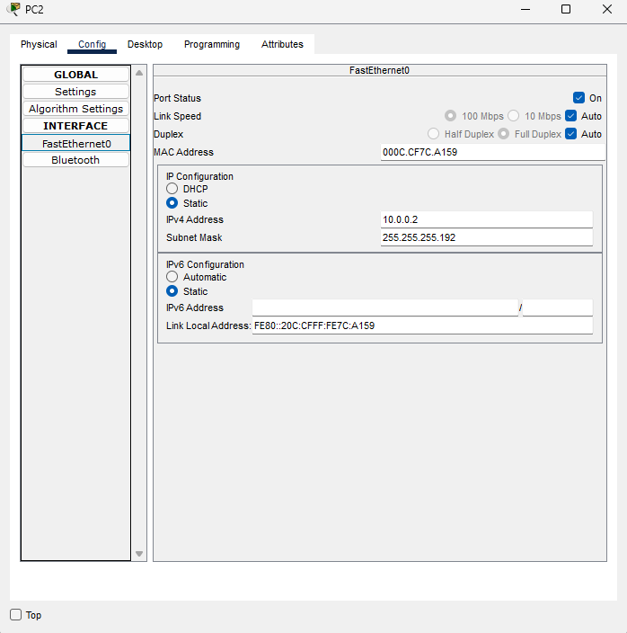
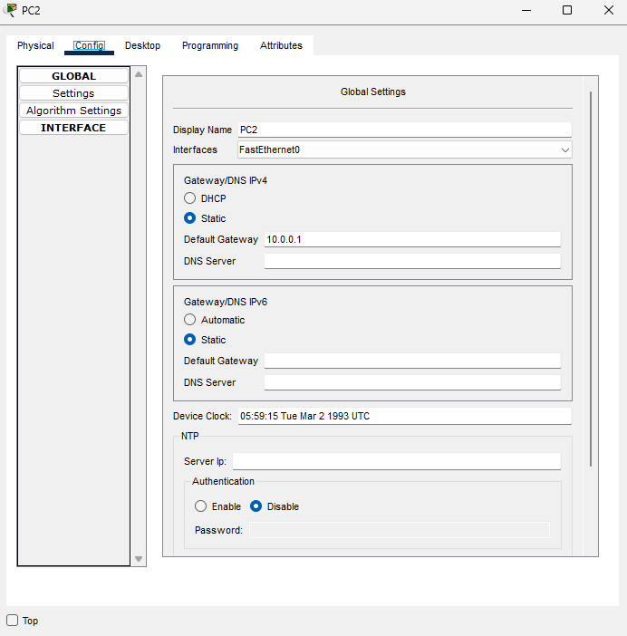

# IP

An IP (Internet Protocol) address in a network is like your ID in your company.
Every device on a network has its own IP address. Public IPs are unique on the internet, while private ranges (like the `10.0.0.0` range we use) are reused inside private networks.

**IP** has two versions, **IPv4** and **IPv6**.
- We used **IPv4** in our company.
- Each subnet in our company has its own range of IPs.
- Each IP address comes with a subnet mask.

# VLSM

Unlike fixed-length subnetting, which wastes a lot of IPs in each subnet, we use **VLSM (Variable Length Subnet Mask)**. It gives each subnet a different mask according to its number of hosts, so fewer IPs are wasted and more address space is left for expansion.

| Name | Available IPs | Subnet | Mask | Gateway |
|---|---|---|---|---|
| Sales | 10.0.0.2 -> 10.0.0.62 | 10.0.0.0/26 | 255.255.255.192 | 10.0.0.1 |
| Purchasing | 10.0.0.66 -> 10.0.0.94 | 10.0.0.64/27 | 255.255.255.224 | 10.0.0.65 |
| Accounting | 10.0.0.98 -> 10.0.0.126 | 10.0.0.96/27 | 255.255.255.224 | 10.0.0.97 |
| Management | 10.0.0.130 -> 10.0.0.158 | 10.0.0.128/27 | 255.255.255.224 | 10.0.0.129 |
| IT | 10.0.0.162 -> 10.0.0.174 | 10.0.0.160/28 | 255.255.255.240 | 10.0.0.161 |

> A gateway IP address (usually your router's local IP) is the IP address your device uses to send data outside your local network, such as to the internet (usually the first or the last usable IP address in the subnet; in our company we use the first one).

## Network and broadcast addresses

In every subnet, the first address is the **network address** and the last one is the **broadcast address**. Neither can be assigned to a device. That is why the available IPs start after the gateway and stop before the broadcast.

| Name | Network | First usable (gateway) | Last usable | Broadcast | Usable hosts |
|---|---|---|---|---|---|
| Sales | 10.0.0.0 | 10.0.0.1 | 10.0.0.62 | 10.0.0.63 | 62 |
| Purchasing | 10.0.0.64 | 10.0.0.65 | 10.0.0.94 | 10.0.0.95 | 30 |
| Accounting | 10.0.0.96 | 10.0.0.97 | 10.0.0.126 | 10.0.0.127 | 30 |
| Management | 10.0.0.128 | 10.0.0.129 | 10.0.0.158 | 10.0.0.159 | 30 |
| IT | 10.0.0.160 | 10.0.0.161 | 10.0.0.174 | 10.0.0.175 | 14 |

Usable hosts = 2^(host bits) - 2. The 2 are the network and broadcast addresses. The gateway also takes one of the usable addresses, so one less is left for devices.

- /26 -> 6 host bits -> 2^6 - 2 = 62
- /27 -> 5 host bits -> 2^5 - 2 = 30
- /28 -> 4 host bits -> 2^4 - 2 = 14

## How the subnets were allocated

1. Sort the departments from the largest to the smallest.
2. Give the first subnet the first block of addresses.
3. Start each next subnet right after the broadcast address of the previous one.
4. A subnet's network address must be a multiple of its block size (64 for /26, 32 for /27, 16 for /28), otherwise subnets overlap.

The next free address is `10.0.0.176`, so a new subnet can be added later without changing the existing ones.

## IP Configuration on Cisco Packet Tracer

Example: PC2 in Sales (`Config` tab).

- IP address and subnet mask according to VLSM

- Gateway

