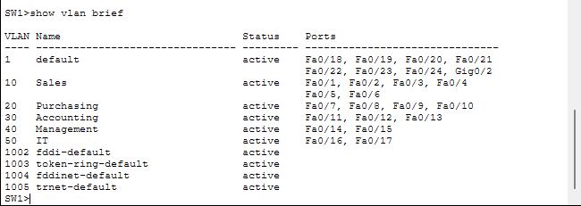
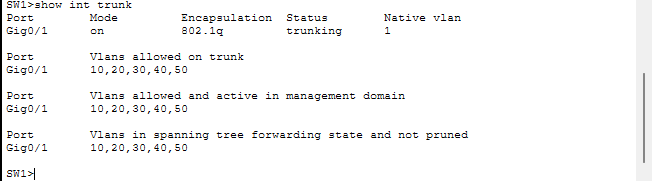
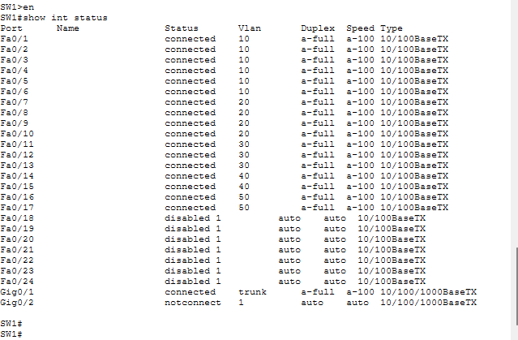

# VLANs and Trunking

## Overview

Let's take a step back to the definition of a LAN.

A LAN is a single **broadcast domain**, meaning all devices in it receive each other's broadcasts.

> What exactly does **broadcast domain** mean?

A broadcast domain is the group of devices that will receive a broadcast frame (destination MAC `FFFF.FFFF.FFFF`) sent by any one of its members.

A **VLAN** (Virtual Local Area Network) is a logical network created inside a physical LAN. It isolates traffic and groups devices as if they were on separate switches. **Each VLAN is its own broadcast domain.**


> Although we separated the five departments into five subnets (Layer 3), they are still in the same broadcast domain (Layer 2) as long as all PCs sit on the same switch with no VLANs. Subnets alone do not isolate anything at Layer 2.

### Why we use VLANs in this project

- **Isolation:** departments such as Accounting are separated from the others.
- **Smaller broadcast domains:** broadcasts stay inside the department.

### The consequence

Once each department is placed in its own VLAN, the switch (a Layer 2 device) forwards frames **only inside the same VLAN**. It will never forward traffic between hosts in different VLANs. To communicate between VLANs we need a Layer 3 device (a router). See [03-inter-vlan-routing.md](03-inter-vlan-routing.md).

> Note: the link between two routers is **not** a VLAN. It is a separate IP subnet (usually a /30). VLANs are a switch concept.

Before the router was added, pinging from one VLAN to another returned `Request timed out`. After adding the router (router-on-a-stick) the ping succeeds.

## How it works

### Access port (Untagged Ports)

- Belongs to **one VLAN** and connects to an end device (PC, printer).
- Frames leave the port **without a tag**; the end device does not know about VLANs.

### Trunk port (tagged Ports)

- Carries **multiple VLANs** over a single link (switch to switch, or switch to router).
- Frames get an **802.1Q tag** that contains the VLAN ID, so the other side knows which VLAN each frame belongs to.
- Without trunks, each VLAN would need its own separate link to the router. This is not viable when the number of VLANs increases: it wastes interfaces, and routers often won't have enough interfaces for each VLAN. A trunk solves this by carrying all VLANs over one link.


### 802.1Q tag

- A 4-byte field inserted in the Ethernet frame between the **Source** and **Type/Length**. It carries the VLAN ID .
- The range of VLANs (1 - 4094) is divided into two sections:<br> 
Normal VLANs: 1 - 1005 <br>
Extended VLANs: 1006 - 4094

### Native VLAN

Traffic that crosses a trunk **without a tag** belongs to the native VLAN (default VLAN 1). The native VLAN must match on both ends of the trunk, otherwise you get warnings and traffic problems.

## VLAN plan

| VLAN ID | Name | Subnet | Mask | Gateway |
|---|---|---|---|---|
| 10 | Sales | 10.0.0.0/26 | 255.255.255.192 | 10.0.0.1 |
| 20 | Purchasing | 10.0.0.64/27 | 255.255.255.224 | 10.0.0.65 |
| 30 | Accounting | 10.0.0.96/27 | 255.255.255.224 | 10.0.0.97 |
| 40 | Management | 10.0.0.128/27 | 255.255.255.224 | 10.0.0.129 |
| 50 | IT | 10.0.0.160/28 | 255.255.255.240 | 10.0.0.161 |

## Port assignment on SW1

> `show vlan brief`    

| Ports | Mode | VLAN | Connected to |
|---|---|---|---|
| Fa0/1 - Fa0/6 | Access | 10 (Sales) | 6 PCs |
| Fa0/7 - Fa0/10 | Access | 20 (Purchasing) | 4 PCs |
| Fa0/11 - Fa0/13 | Access | 30 (Accounting) | 3 PCs |
| Fa0/14 - Fa0/15 | Access | 40 (Management) | 2 PCs |
| Fa0/16 - Fa0/17 | Access | 50 (IT) | 2 PCs |
| Gi0/1 | Trunk | 10,20,30,40,50 | R1 G0/0 |

## Configuration

All commands run on `SW1`.

### 1. Create and name the VLANs

```
SW1(config)# vlan 10
SW1(config-vlan)# name Sales
SW1(config-vlan)# vlan 20
SW1(config-vlan)# name Purchasing
SW1(config-vlan)# vlan 30
SW1(config-vlan)# name Accounting
SW1(config-vlan)# vlan 40
SW1(config-vlan)# name Management
SW1(config-vlan)# vlan 50
SW1(config-vlan)# name IT
```

Creating a VLAN is not enough. Ports must be assigned to it (next step).

### 2. Assign access ports (example: Sales)

```
SW1(config)# interface range fa0/1 - 6
SW1(config-if-range)# switchport mode access
SW1(config-if-range)# switchport access vlan 10
```

- `interface range` applies the same commands to a group of ports.
- `switchport mode access` forces the port to be an access port.
- `switchport access vlan 10` places the port in VLAN 10.

The same three lines are repeated for each department with its own port range and VLAN ID.

### 3. Configure the trunk toward the router

```
SW1(config)# interface gigabitEthernet 0/1
SW1(config-if)# switchport mode trunk
SW1(config-if)# switchport trunk allowed vlan 10,20,30,40,50
```

- `switchport mode trunk` makes the link carry multiple VLANs with 802.1Q tags.
- `allowed vlan` limits which VLANs may cross the trunk.

The 2960 in Packet Tracer supports only 802.1Q, so the `switchport trunk encapsulation dot1q` command is not needed (and is rejected). Layer 3 switches such as the 3560 require it.

## Verification

```
SW1# show vlan brief
SW1# show interfaces trunk
SW1# show interfaces status
```

What to look for:

- `show vlan brief`: each VLAN lists its correct ports, and those ports no longer appear under `default`.
- `show interfaces trunk`: `Gi0/1` has status `trunking` with encapsulation `802.1q`, and the allowed VLANs are 10,20,30,40,50.
- A ping from a PC to its own gateway (for example `10.0.0.1` from Sales) succeeds.

### Screenshots

`show vlan brief`



`show interfaces trunk`



`show interfaces status`


