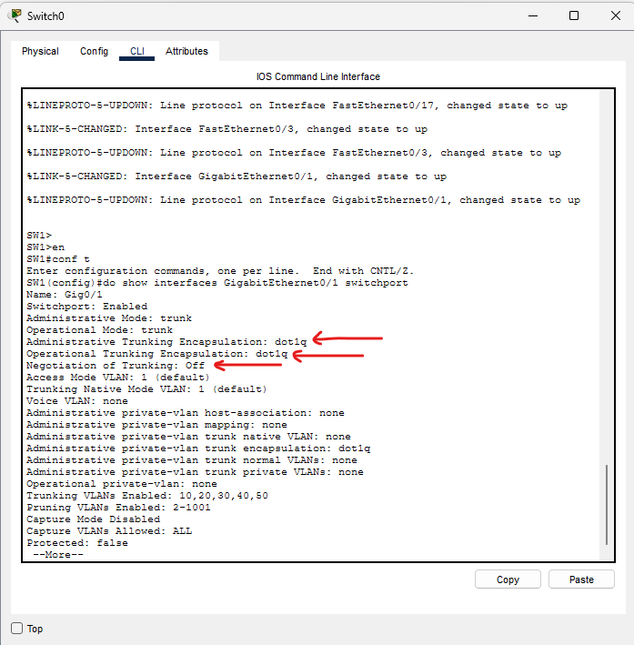
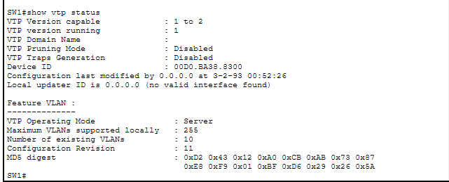

# DTP

Dynamic Trunking Protocol (DTP) is a Cisco-proprietary Layer 2 protocol used between switches to automatically negotiate whether a link becomes a trunk (carrying multiple VLANs) or an access link (carrying a single VLAN).

* DTP is enabled by default on all Cisco switch interfaces (by default in **Dynamic Auto** mode).

* DTP will not form a trunk with a router, PC, etc.; the switchport will remain in **Access** mode.

* Switches that support both 802.1Q and ISL trunk encapsulations can use DTP to negotiate which encapsulation they will use.

* This negotiation is enabled by default, as the default trunk encapsulation mode is: `switchport trunk encapsulation negotiate`.

* ISL is favored over 802.1Q, so if both switches support ISL it will be selected.

* DTP frames are sent in VLAN 1 when using ISL, or in the native VLAN when using 802.1Q (the default native VLAN is VLAN 1).

> For security purposes, manual trunk configuration is recommended, and DTP should be disabled on switchports using `switchport nonegotiate` (note: this command only works when the port is manually set to `trunk` or `access`, not `dynamic`).

| Mode | Behavior | 
| ----- | ----- | 
| Dynamic Auto | Passive; waits for the other side to start a trunk. | 
| Dynamic Desirable | Active; tries to start a trunk with the other side. | 
| Trunk | Always a trunk; asks the other side to become a trunk too. | 
| Access | Always an access port; refuses to become a trunk. | 

| Administrative Mode | Trunk | Dynamic Desirable | Access | Dynamic Auto | 
| ----- | ----- | ----- | ----- | ----- | 
| **Trunk** | Trunk | Trunk | X | Trunk | 
| **Dynamic Desirable** | Trunk | Trunk | Access | Trunk | 
| **Access** | X | Access | Access | Access | 
| **Dynamic Auto** | Trunk | Trunk | Access | Access | 

How to configure it?

```
Switch(config)# interface GigabitEthernet0/1
Switch(config-if)# switchport mode dynamic desirable   
Switch(config-if)# switchport mode dynamic auto         
Switch(config-if)# switchport mode trunk                
Switch(config-if)# switchport nonegotiate                

```

### Screenshots

This will show you **Administrative Mode / Trunking Encapsulation** (what you configured) and **Operational Mode / Trunking Encapsulation** (what the switches negotiated):

`show interfaces GigabitEthernet0/1 switchport`



# VTP

VLAN Trunking Protocol (VTP) is a Cisco-proprietary Layer 2 protocol used to automatically synchronize VLAN configurations (creating, renaming, or deleting VLANs) across all switches in the same VTP domain over trunk links.

* VTP is enabled by default on Cisco switches (by default in **Server** mode with no domain name).

* VTP messages are only sent over **Trunk** links using VLAN 1 (or the native VLAN).

* To synchronize VLANs between switches, they must share the same **VTP Domain Name** (case-sensitive), **VTP Version**, and **VTP Password** (if configured).

* VTP tracks updates using a **Configuration Revision Number** that increases by 1 every time a VLAN is added, modified, or deleted on a Server.

> Always be careful when adding a switch with a higher revision number to the network, as it can overwrite existing VLANs. Set new switches to **Transparent** mode first to reset their revision number to `0`, or use **VTP Version 3**.

| Mode | Behavior | 
| ----- | ----- | 
| Server | Can create, modify, and delete VLANs; sends updates to other switches and saves VLANs in NVRAM (default mode). | 
| Client | Cannot create, modify, or delete VLANs; receives updates from a Server and syncs its VLAN database automatically. | 
| Transparent | Ignores VTP updates for itself (uses only its own local VLANs), but forwards VTP messages to other switches. | 

How to configure it?

```
Switch(config)# vtp domain CORP_NET
Switch(config)# vtp mode server
Switch(config)# vtp password Cisco123
Switch(config)# vtp version 2

```

### Verification

This will show you the **VTP Operating Mode**, **Domain Name**, **Version**, and **Configuration Revision Number**:

`show vtp status`


---

### Topology Design Note (Single-Switch Setup)

> Since this topology uses only a single switch, **VTP** synchronization across multiple switches is not needed, so the switch is configured in `vtp mode transparent` to prevent unintended VLAN overwrites. Similarly, **DTP** is disabled (`switchport nonegotiate`) on all interfaces—using static `access` mode for end devices and static `trunk` mode only for the uplink to the router (Router-on-a-Stick).